  

  
  

I build end-to-end AI systems: machine learning models, production APIs, and the automation around them. I come from Mechanical Engineering, which shaped how I approach software: with structure, analytical rigor, and a focus on results.

## What I am working on

- **[Lomiens](https://lomiens.com)**, founder. A platform for hotel operations: guest app, staff queues, and manager analytics, in one product.
- **wehandle**, AI and Automation. RAG systems, agentic pipelines, and backend APIs built from scratch for client integration.
- **FAPESP**, Machine Learning research. Anomaly forecasting in oil wells, comparing deep learning and gradient boosting.

## Selected projects

| Project | What it is | Stack |
|---|---|---|
| [last-mile-rag-lab](https://github.com/CaioMoraes-enginer/last-mile-rag-lab) | Reproducible RAG benchmark for logistics decisions, with a synthetic corpus and LLM evaluation | Python, RAG, LLM evaluation |
| [severe-slugging-prognosis](https://github.com/CaioMoraes-enginer/severe-slugging-prognosis) | Severe slugging prognosis in offshore wells, using time series on the 3W dataset | Python, LSTM, XGBoost, SHAP |
| [dk-idiomas](https://github.com/CaioMoraes-enginer/dk-idiomas) | [Education platform in production](https://app.dkidiomas.com.br) with authentication and role-based access | React, TypeScript, Firebase |
| [DK Idiomas landing page](https://github.com/CaioMoraes-enginer/DK_Idiomas_Landing_Page) | [Bilingual commercial site](https://dkidiomas.com.br), responsive and optimized for search | HTML, Tailwind CSS, GSAP |

## Tech

  
  
  
  
  
  
  
  
  
  
  

**Engineering methods:** Six Sigma Black Belt, Design of Experiments, API design, ETL

## Background

- **Mechanical Engineering** at UNESP, Brazil, with a double degree at Hochschule Albstadt-Sigmaringen, Germany
- Previous experience at **Bosch Sensortec** (Germany) and **Embraer**
- Published in *Energies* (MDPI, 2025): *Efficiency and Energy Consumption of Partial Carbonation Process for CO₂ Capture from Natural Gas Combustion*

I am open to opportunities in Machine Learning, Backend Development, and AI Automation.
