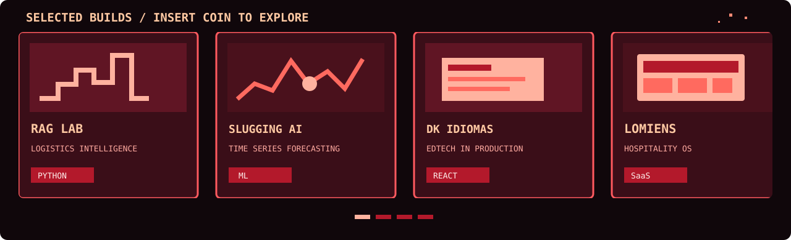
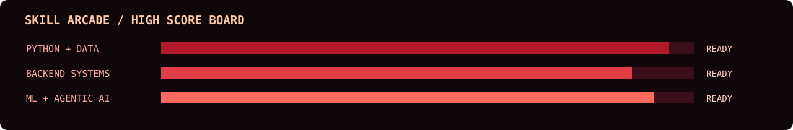

<p align="center">
  
</p>

<p align="center">
  <a href="https://www.linkedin.com/in/caio-moraes-5687-"></a>
  <a href="https://lomiens.com"></a>
  
</p>

<p align="center"><sub><b>BUILDING SYSTEMS THAT TURN COMPLEXITY INTO LEVERAGE.</b></sub></p>


## `> boot --whoami`

I am **Caio Moraes** — Mechanical Engineer turned **AI / ML / Backend** builder. I ship the whole loop: data and models, production APIs, automations, and the product layer that makes it useful.

<p align="center"></p>


## `> ls ./featured-work`

<p align="center"></p>

| Project | The mission | Stack |
| --- | --- | --- |
| [**last-mile-rag-lab**](https://github.com/CaioMoraes-enginer/last-mile-rag-lab) | Reproducible RAG benchmark for logistics decisions | Python · RAG · LLM evaluation |
| [**severe-slugging-prognosis**](https://github.com/CaioMoraes-enginer/severe-slugging-prognosis) | Offshore well anomaly forecasting on the 3W dataset | Python · LSTM · XGBoost · SHAP |
| [**dk-idiomas**](https://github.com/CaioMoraes-enginer/dk-idiomas) | [Production education platform](https://app.dkidiomas.com.br) | React · TypeScript · Firebase · RBAC |
| [**DK Idiomas Landing Page**](https://github.com/CaioMoraes-enginer/DK_Idiomas_Landing_Page) | [Bilingual commercial landing page](https://dkidiomas.com.br) | HTML · Tailwind · GSAP · SEO |


## `> cat ./toolbelt.json`

<p align="center"></p>

<p align="center">
  
  
  
  
  
  
</p>

**Also in the inventory:** Scikit-learn · XGBoost · LSTM · RAG · Agentic pipelines · API design · ETL · Six Sigma Black Belt · Design of Experiments.


## `> profile --origin-story`

- Mechanical Engineering at **UNESP**; double degree at Hochschule Albstadt-Sigmaringen, Germany.
- Experience at **Bosch Sensortec** and **Embraer**.
- Research published in *Energies* (MDPI, 2025): carbon-capture process efficiency from natural-gas combustion.

```text
STATUS: AVAILABLE FOR HIGH-LEVERAGE BUILDS
FOCUS:  AI systems · ML engineering · Backend · Automation
MODE:   curious, pragmatic, relentlessly iterative
```

<p align="center"><sub>Made with structured chaos, good coffee, and an unreasonable number of pixels.</sub></p>
